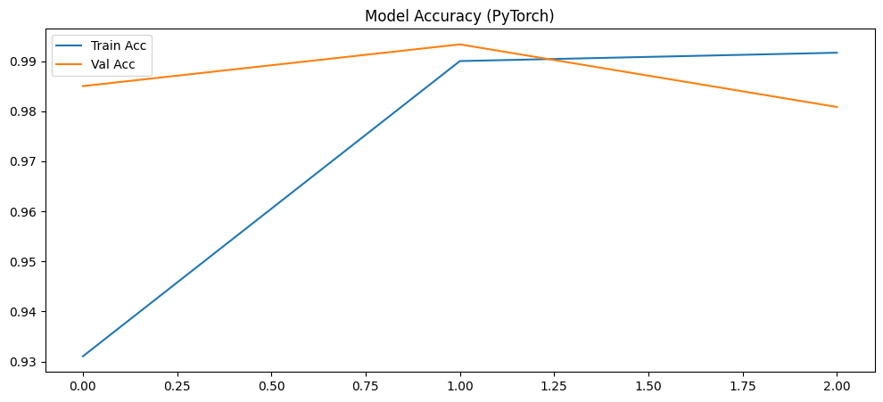
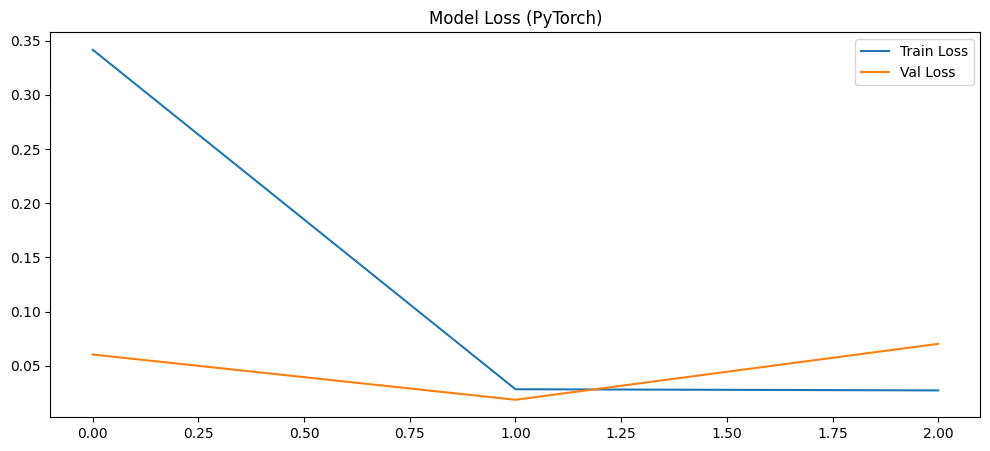

# PyTorch CNN Satellite Image Classifier

Implementing, training and testing a **convolutional neural network (CNN) in PyTorch** that classifies 64 x 64 satellite image tiles as **agricultural** or **non-agricultural** land, using a manual training loop, data augmentation, batch normalization, dropout and best-model checkpointing.


---

## Table of Contents

1. [Overview](#overview)
2. [Dataset](#dataset)
3. [Project Workflow](#project-workflow)
4. [Model Architecture](#model-architecture)
5. [Training Setup](#training-setup)
6. [Results](#results)
7. [Concepts Covered](#concepts-covered)
8. [Repository Structure](#repository-structure)
9. [Getting Started](#getting-started)
10. [Limitations and Future Work](#limitations-and-future-work)
11. [Tech Stack](#tech-stack)
12. [Acknowledgements](#acknowledgements)
13. [License](#license)

---

## Overview

Classifying land use from satellite images supports tasks such as monitoring farmland. This project builds the full PyTorch workflow for that task, with the training loop written by hand instead of using a high-level trainer:

- Reproducible setup (global seeds, seeded DataLoader workers, seeded train/validation split)
- Separate transforms: **augmented** for training, **plain** for validation
- A 6-block CNN with batch normalization and dropout, built with `nn.Sequential`
- A manual training and validation loop with `tqdm` progress bars and per-epoch metrics
- Saving the best model by validation loss
- Plotting accuracy and loss curves and computing accuracy with scikit-learn

## Dataset

Satellite image tiles, downloaded automatically in the notebook (about 20 MB):

```
https://cf-courses-data.s3.us.cloud-object-storage.appdomain.cloud/4Z1fwRR295-1O3PMQBH6Dg/images-dataSAT.tar
```

| Property | Value |
|---|---|
| Classes | 2 (`class_0_non_agri` = 0, `class_1_agri` = 1) |
| Images | 6,000 in total (3,000 per class) |
| Image size | 64 x 64 pixels, RGB |
| Training / validation split | 80% / 20% (seeded random split) |

```
images_dataSAT/
├── class_0_non_agri/    # non-agricultural land (label 0)
└── class_1_agri/        # agricultural land (label 1)
```

## Project Workflow

| Step | What was done |
|---|---|
| 1. Setup | Installed and imported PyTorch, torchvision, scikit-learn, NumPy and Matplotlib; set the global seed (42) and a `worker_init_fn` for DataLoader workers |
| 2. Data download | Downloaded and extracted the dataset |
| 3. Transforms | `train_transform`: resize, `RandomRotation(40)`, `RandomHorizontalFlip`, `RandomAffine(shear=0.2)`, `ToTensor`, `Normalize` (ImageNet mean and std). `val_transform`: resize, `ToTensor`, `Normalize` only |
| 4. Datasets | Two `ImageFolder` datasets (one per transform), split 80/20 with a seeded `random_split`, wrapped in `Subset` |
| 5. DataLoaders | `train_loader` (shuffled) and `val_loader` (not shuffled), batch size 128, 4 workers |
| 6. Model | CNN with six convolution blocks and a dense classifier |
| 7. Training | `CrossEntropyLoss`, Adam (lr = 0.001), 3 epochs; best model saved by validation loss |
| 8. Evaluation | Accuracy and loss curves, predictions on the validation set and `accuracy_score` |

## Model Architecture

```
Input (3 x 64 x 64)
  |
6 x [ Conv2d (5x5, padding 2) -> ReLU -> MaxPool2d(2) -> BatchNorm2d ]
      channels: 32 -> 64 -> 128 -> 256 -> 512 -> 1024
  |
AdaptiveAvgPool2d(1) -> Flatten                # 1024 features
  |
Linear(1024 -> 2048) -> ReLU -> BatchNorm1d -> Dropout(0.4)
  |
Linear(2048 -> 2)                              # class scores (logits)
```

The model has about **19.6 million trainable parameters** (calculated from the layer sizes).

## Training Setup

| Setting | Value |
|---|---|
| Loss | `nn.CrossEntropyLoss` (raw logits and integer class labels) |
| Optimizer | Adam, learning rate 0.001 |
| Batch size | 128 |
| Epochs | 3 |
| Checkpoint | Best model by validation loss, saved as `ai_capstone_pytorch_state_dict.pth` |
| Hardware | CPU (about 3 minutes per epoch) |
| Seed | 42 |

## Results

| Epoch | Train loss | Val loss | Train accuracy | Val accuracy |
|---|---|---|---|---|
| 1 | 0.3416 | 0.0604 | 0.9310 | 0.9850 |
| **2** | **0.0283** | **0.0186** | **0.9900** | **0.9933** |
| 3 | 0.0273 | 0.0702 | 0.9917 | 0.9808 |

- The **best epoch was epoch 2** (lowest validation loss, 0.0186, and highest validation accuracy, 99.33%). That is the model saved to disk.
- After the last epoch (epoch 3), validation accuracy is **98.08%**.
- Validation accuracy is already above 98% after the first epoch, which shows how separable the two classes are.





## Concepts Covered

The notebook includes short written answers on:

- **Weight initialization:** random initialization lets each neuron start differently, which enables effective learning and convergence.
- **`tqdm`:** provides a progress bar to monitor each epoch.
- **Per-epoch metric variables:** they are reset each epoch because they accumulate metrics for that epoch only.
- **`torch.no_grad()` in validation:** disables gradient calculation, which is not needed for validation.
- **Why transforms differ:** augmentation is applied to training data only, so validation measures performance on unmodified images.

## Repository Structure

```
pytorch-cnn-satellite-classifier/
├── notebooks/
│   └── PyTorch_CNN_Satellite_Classifier.ipynb   # Full notebook with outputs
├── images/
│   ├── accuracy_curve.png
│   └── loss_curve.png
├── .gitignore
├── LICENSE
├── README.md
└── requirements.txt
```

## Getting Started

### Prerequisites

- Python 3.9 to 3.12
- An internet connection (the dataset downloads when the notebook runs)
- About 10 minutes for the 3-epoch run on a CPU

### Installation

```bash
# 1. Clone the repository
git clone https://github.com/<your-username>/pytorch-cnn-satellite-classifier.git
cd pytorch-cnn-satellite-classifier

# 2. (Recommended) create a virtual environment
python -m venv .venv
source .venv/bin/activate        # Windows: .venv\Scripts\activate

# 3. Install dependencies
pip install -r requirements.txt
```

For a smaller CPU-only PyTorch build:

```bash
pip install torch torchvision --index-url https://download.pytorch.org/whl/cpu
```

### Run the notebook

```bash
jupyter notebook notebooks/PyTorch_CNN_Satellite_Classifier.ipynb
```

Use **Kernel > Restart & Run All**. The dataset is extracted to `images_dataSAT/` and the best model is saved as `ai_capstone_pytorch_state_dict.pth`. Both are ignored by git.

> The notebook starts with `%pip install` cells written for the Skills Network Labs environment. If you installed the dependencies with `requirements.txt`, you can skip them. Run the prediction cell in the evaluation section only **after** training has finished, because it uses the trained model.

## Limitations and Future Work

- **No separate test set.** The validation set is used both to pick the best epoch and to report results, so the figures are slightly optimistic.
- **Only 3 epochs.** Validation loss was lowest at epoch 2 and rose at epoch 3, so training longer would need early stopping or a learning-rate schedule.
- **Large model for a small dataset.** The network has about 19.6 million parameters and 4,800 training images. A smaller network or transfer learning (for example ResNet or MobileNet) would be lighter.
- Only accuracy is reported. A confusion matrix and per-class precision, recall and F1 would give a fuller picture.
- The saved checkpoint is the epoch with the best validation loss (epoch 2), but the in-memory model at the end of training is the epoch 3 model. Reloading the saved weights before evaluation would make the final numbers match the best epoch.
- Possible extensions: Grad-CAM heatmaps, a comparison with the Keras version of this classifier, and a prediction script for new images.

## Tech Stack

- **Python**
- **PyTorch** and **torchvision**: model, datasets, transforms and training
- **scikit-learn**: accuracy metric
- **NumPy**, **Matplotlib** and **tqdm**: arrays, plots and progress bars
- **skillsnetwork**: dataset download helper
- **Jupyter Notebook**

## Acknowledgements

- Completed as part of the IBM AI Engineering course (IBM Skills Network). The lab structure, instructions and dataset are from that course and are © IBM Corporation.
- My work in the notebook: the train and validation transforms, the DataLoaders, the written answers, the training-curve plots and the prediction and accuracy cells.

## License

My code is released under the [MIT License](LICENSE). The lab instructions and dataset remain © IBM Corporation.
